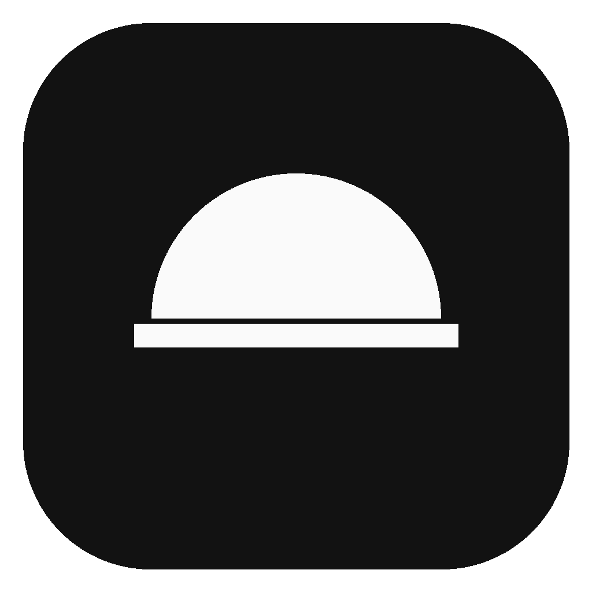
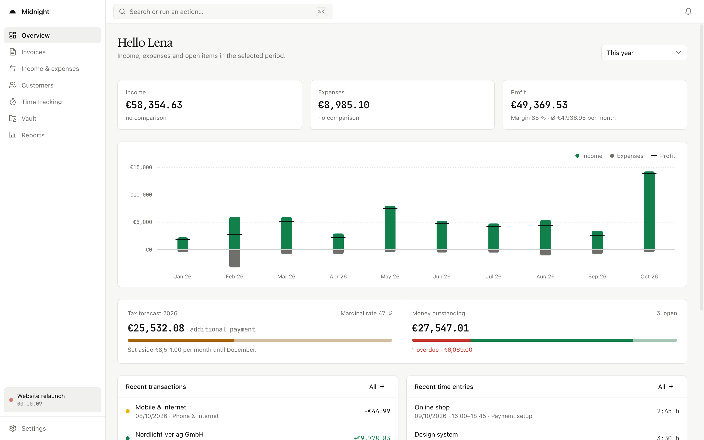
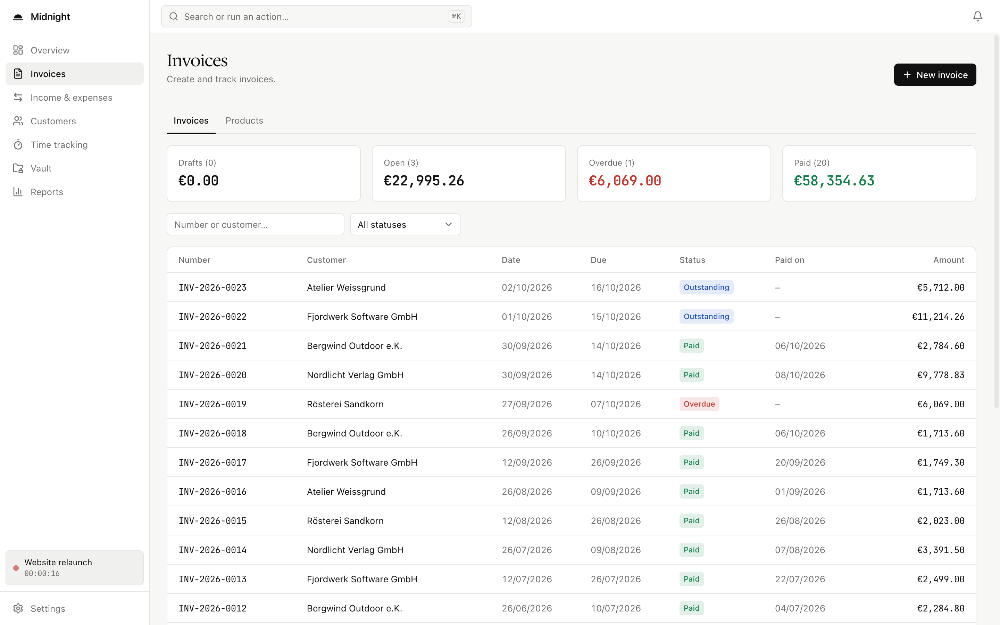
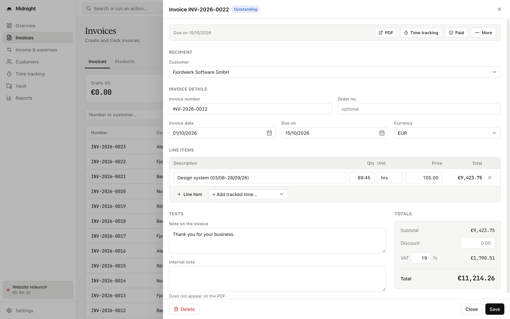
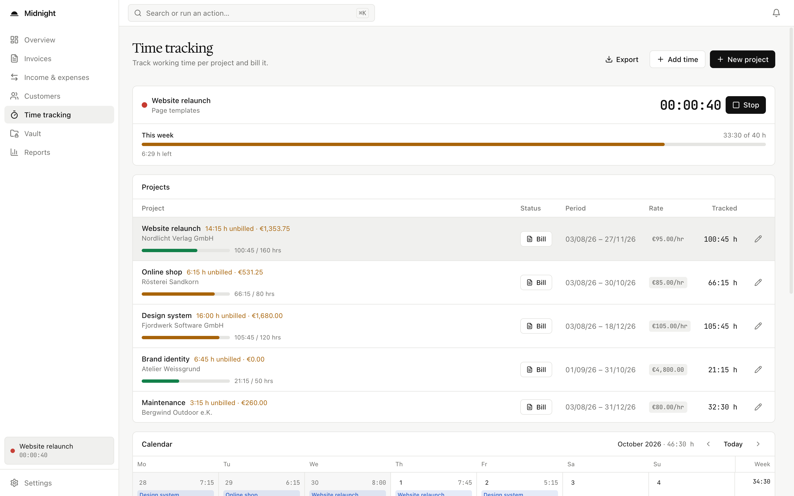
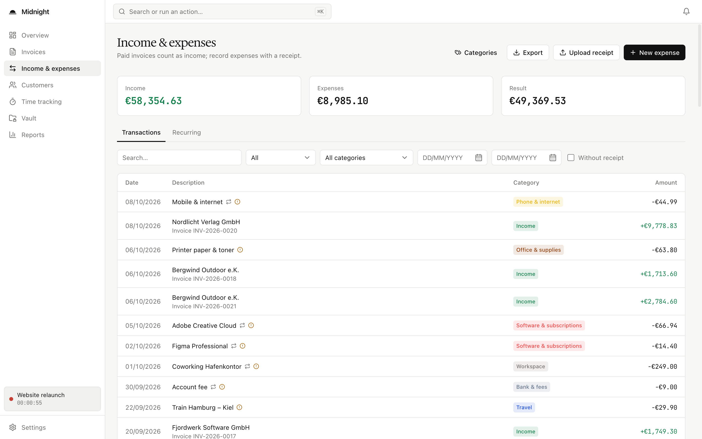
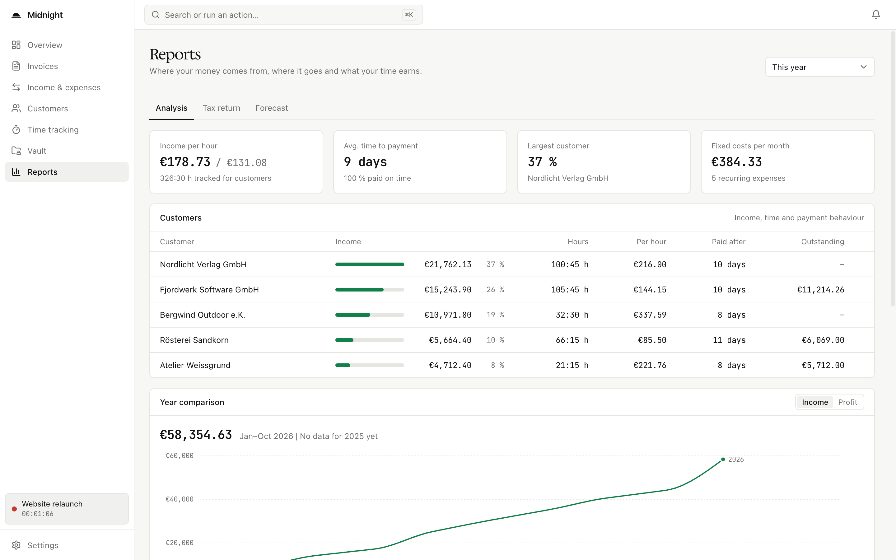
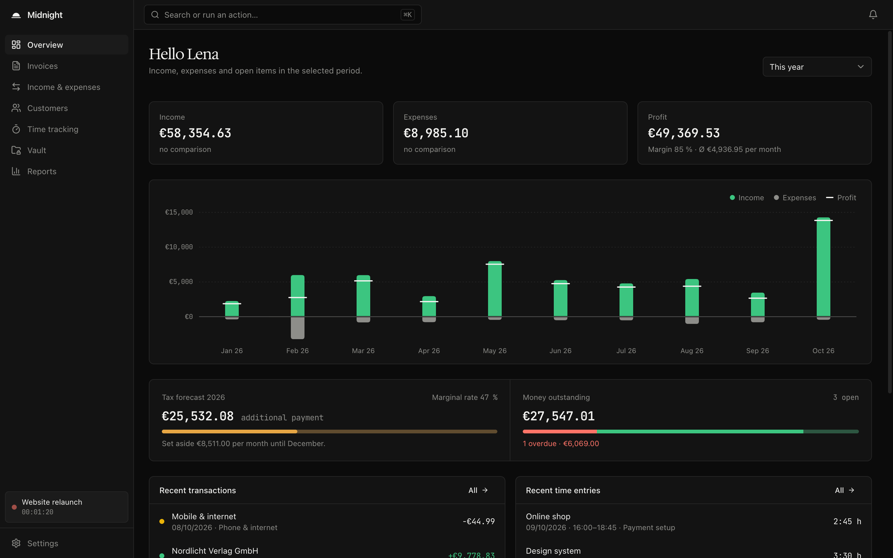

<div align="center">



# Midnight

**Local bookkeeping for freelancers and self-employed in Germany.**

[](https://github.com/jannikmenzel/midnight/actions/workflows/ci.yml)
[](https://github.com/jannikmenzel/midnight/releases)
[](LICENSE)
[](#installation)
<br />
[](https://tauri.app)
[](https://www.rust-lang.org)
[](https://react.dev)
[](https://www.typescriptlang.org)
[](https://www.sqlite.org)
[](#mcp-server)

</div>

<picture>
  <source media="(prefers-color-scheme: dark)" srcset="docs/screenshots/overview-dark.png" />
  
</picture>

## Features

| Area | What it covers |
| --- | --- |
| Overview | Income, expenses, profit and open items for the selected period, unbilled time |
| Income & expenses | Paid invoices as income, expenses with receipts, extracting name, amount and date from PDF receipts, CSV export |
| Categories | Custom expense categories, pre-filled with typical items for the German EÜR (cash-basis profit statement) |
| Invoices | Number sequences, line items, VAT and discounts, small business scheme under § 19 UStG, PDF export via LaTeX, e-invoices (ZUGFeRD/Factur-X EN 16931 and XRechnung 3.0), duplicating, saved products |
| Customers | Customer and order numbers, revenue and tracked time per customer, archive |
| Time tracking | Projects with hourly rate, budget or fixed price, timer, manual entries, billing unbilled time as a draft invoice, timesheet export |
| Vault | Document storage with document type, customer and tags, full-text search in PDF text |
| Reports | Monthly trend, margin, categories, forecast for the next three months |
| Tax | Annual income tax estimate: self-employment, employment, home office allowance, volunteering, health insurance, special expenses, hints on deadlines and limits |
| Other | ⌘K search, notifications, background jobs every 15 minutes, light and dark theme, English and German UI |

## Screenshots

| | |
| --- | --- |
|  |  |
| **Invoices** – status totals and all invoices at a glance | **Invoice editor** – line items from tracked time, VAT and totals |
|  |  |
| **Time tracking** – running timer, weekly limit and project budgets | **Income & expenses** – paid invoices and expenses with categories |
|  |  |
| **Reports** – income per hour, payment behaviour and year comparison | **Dark mode** – follows the system or can be set in the settings |

All screenshots show fictional demo data.

## Installation

Download the latest `.dmg` for Apple Silicon (`aarch64`) or Intel (`x64`) from
[Releases](https://github.com/jannikmenzel/midnight/releases) and drag Midnight into **Applications**.

The app is not notarized by Apple. On first launch macOS will block it; open **System Settings / Privacy & Security**
and click **Open Anyway**, or remove the quarantine flag:

```bash
xattr -dr com.apple.quarantine /Applications/Midnight.app
```

**Required for PDFs:** install [MacTeX](https://www.tug.org/mactex/) (or TeX Live). Invoices and timesheets are
typeset with LaTeX (`xelatex`); without it, no PDFs can be created.

## Development

Requirements: Node 20+, and on macOS the Xcode Command Line Tools. The Rust version is pinned in `rust-toolchain.toml`.

```bash
npm install
npm run tauri dev
npm run tauri build
npm run build
cd src-tauri && cargo test
```

Releases are built by GitHub Actions when a `v*` tag is pushed (`.github/workflows/release.yml`) and published as a
draft release.

The database schema lives in `src-tauri/migrations/`. New schema changes go into an additional, sequentially numbered
file and are registered in `MIGRATIONS` in `src-tauri/src/db.rs`.

## MCP server

`midnight-mcp` exposes the app's features as MCP tools over stdio, for both reading and writing. It works directly on
the same database and also runs while the app is closed. Resetting all data is only possible inside the app.

The installed app ships with the server:

```bash
claude mcp add midnight -- /Applications/Midnight.app/Contents/MacOS/midnight-mcp
```

From source:

```bash
cd src-tauri && cargo build --release --bin midnight-mcp
claude mcp add midnight -- "$PWD/target/release/midnight-mcp"
```

A different data directory can be set via `MIDNIGHT_DATA_DIR`. New commands are registered in
`src-tauri/src/commands.rs`; each entry produces both a Tauri command and an MCP tool.

## Data

On macOS, data is stored in `~/Library/Application Support/app.midnight.desktop/`: the database `midnight.db` and the
`files/` folder with receipts, invoice PDFs and documents. Back up this folder to keep your data safe.

## Contributing

Contributions are welcome — see [CONTRIBUTING.md](CONTRIBUTING.md) for setup, checks and conventions. Notable
changes are listed in [CHANGELOG.md](CHANGELOG.md).

## License

Copyright (c) 2026 Jannik Menzel. Licensed under AGPL-3.0, see `LICENSE`.

Third-party components:

- **Postal codes:** The offline postcode and town suggestions use data from [GeoNames](https://www.geonames.org/),
  licensed under [CC BY 4.0](https://creativecommons.org/licenses/by/4.0/) (see `src-tauri/data/README.md`).
- **Interface fonts:** Hedvig Letters Serif and JetBrains Mono, licensed under the
  [SIL Open Font License 1.1](https://openfontlicense.org).
- **LaTeX template fonts:** Inter, Poppins and JetBrains Mono in `src-tauri/templates/Fonts/`, licensed under the
  [SIL Open Font License 1.1](https://openfontlicense.org).
- **Libraries:** All Rust crates and npm packages shipped with the app are listed with their licenses in
  `THIRD_PARTY_NOTICES.txt`, which is bundled inside `Midnight.app` together with `LICENSE`. The file is generated
  during the release build by `scripts/third_party_notices.sh`.

## Acknowledgements

Midnight was inspired by [Midday](https://github.com/midday-ai/midday). Thanks to the Midday team for sharing their
work as open source.
